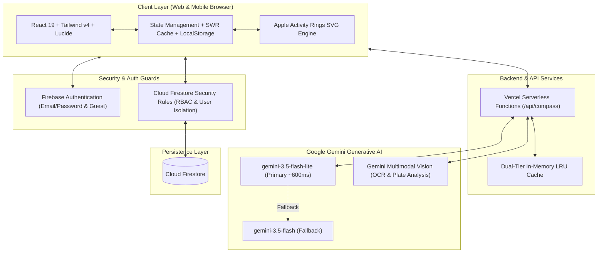

<div align="center">

  <svg xmlns="http://www.w3.org/2000/svg" width="64" height="64" viewBox="0 0 48 48" fill="none">
    <rect x="6" y="6" width="36" height="36" rx="11" fill="#082b20"/>
    <rect x="11.5" y="11.5" width="25" height="25" rx="8" fill="#0a7a53"/>
    <rect x="17" y="17" width="14" height="14" rx="4.5" fill="#4ade80"/>
    <circle cx="20.5" cy="20.5" r="2.5" fill="#ffffff" fill-opacity="0.95"/>
  </svg>

  # RECOMPASS
  ### Campus Nutrition Operating System & AI Dietitian

  **Hit your daily macros. Even with hostel mess food.**

  [](https://react.dev/)
  [](https://www.typescriptlang.org/)
  [](https://tailwindcss.com/)
  [](https://ai.google.dev/)
  [](https://firebase.google.com/)
  [](https://vercel.com/)

  ---

  [Live Demo](https://recompass.vercel.app) &bull; [Key Workflows](#-key-core-workflows) &bull; [Architecture](#-system-architecture) &bull; [Getting Started](#-local-setup--development)

</div>

---

## 📌 Executive Summary

**Recompass** is an end-to-end nutritional management system built specifically for university students living in hostel dormitories and dining at institutional messes. 

Generic fitness tracking apps (MyFitnessPal, HealthifyMe, MacroFactor) make an unviable assumption: that users have home kitchens, digital food scales, and barcode-labeled ingredients. In a university mess hall, food is prepared in bulk, served in mess utensils (ladles, paddles, pieces), and changes every day according to a notice board timetable.

Recompass bridges this gap with an intelligent multimodal AI engine, hardware-calibrated portion models, and a hostel-centric pantry and recipe manager.

---

## 🎯 The Problem

1. **Uncalibrated Mess Hall Dining**: Mess halls do not publish caloric or macronutrient data. Asking students to weigh dal or rice in grams with a kitchen scale at a cafeteria counter is socially and practically impossible.
2. **Volatile Weekly Schedules**: Mess committees rotate menus across Breakfast, Lunch, Snacks, and Dinner across 7 days. Students often skip meals or over-consume carbs without realizing it.
3. **Dorm Room Cooking Constraints**: When mess food is unpalatable or protein-deficient, students cook in dorm rooms using restricted appliances (electric kettles, induction plates, sandwich toasters, air fryers). Generic recipe apps recommend 4-burner stovetops and 20 exotic ingredients.
4. **Disconnected Macro Math**: Most apps fail to accurately distinguish between Body Recomposition (recomp) and Maintenance, forcing rigid formulas that ignore whether a user knows their body fat percentage or not.

---

## ⚡ Key Core Workflows

```
┌────────────────────────────────────────────────────────────────────────┐
│                        RECOMPASS OS WORKFLOWS                         │
└────────────────────────────────────────────────────────────────────────┘
       │                        │                        │
       ▼                        ▼                        ▼
 1. Timetable OCR         2. Tactical Daily Log     3. Dorm Cook Engine
    (Vision AI)             (Apple Activity Rings)     (Hardware Synced)
       │                        │                        │
       ▼                        ▼                        ▼
 4. Compass AI Agent      5. Biometric Recomp       6. Auto-Deduct Pantry
    (Plate & Q&A)            (Katch-McArdle/Mifflin)    (Restock to Groceries)
```

### 1. Weekly Mess Menu Scanner (Multimodal OCR)
- Upload a notice board photo or PDF schedule of the mess timetable.
- Powered by **Gemini Vision AI**, the scanner parses days (Monday–Sunday) and meal slots (Breakfast, Lunch, Dinner).
- Strips dirty formatting, portion suffixes (`Banana - 1pc` &rarr; `Banana`), and normalizes dish names into title case.
- Automatically generates the user's interactive weekly schedule.

### 2. Tactical Daily Log & Apple Fitness Macro Rings
- Visualized using high-fidelity **Apple Fitness activity rings** for Calories, Protein, Carbs, and Fats.
- Eliminates kitchen scale requirements using **calibrated Indian mess units**:
  - Liquid Curries/Dal: `1 ladle (~100ml)`
  - Rice/Biryani: `1 paddle (~150g)`
  - Milk/Tea/Beverages: `1 cup (150ml)` or `1 mug (250ml)`
  - Breads/Eggs/Bananas: `1 piece` / `2 pieces`
  - Sabzi/Dry Bhaji: `1 serving`
  - Spreads (Peanut Butter, Jam, Mayo): `1 tbsp (~15g)`
- **Optimistic 0ms UI**: When picking portions, live macros are calculated in real time. Tapping *"Log Food"* logs instantly to state and updates rings with zero blocking spinners.
- **Custom Staples**: Save repeat dorm meals (e.g., *"Whey in 250ml Milk"*) to log with 1 tap.

### 3. Dorm Room Cook Engine
- Generates high-protein student recipes using only what's currently in your pantry.
- **Hostel Hardware Settings**: Filter by available dorm gear (*Electric Kettle, Induction Cooktop, Microwave, Sandwich Toaster, Air Fryer, No-Cook Shake*).
- **Culinary Flavor Isolation**: Strict sweet vs. savory rules prevent bizarre AI recipe hallucinations (guarantees zero fruit in egg omelettes and zero savory spices in sweet dessert oats).
- **Skill Tier Customization**: Beginner (1-kettle dump & heat), Intermediate, or Hostel Masterchef.

### 4. Dorm Pantry & Inventory Deduction Synergy
- Track groceries, snacks, protein powders, oats, spreads, and milk.
- Unit-aware stock status evaluation (*In Stock, Low Stock, Depleted*).
- **Cook-to-Pantry Synergy**: Logging a cooked recipe automatically calculates and deducts pantry inventory (e.g., deducting 30g whey powder and 200ml milk).
- **Low-Stock Alert & 1-Tap Restock**: Depleted pantry items can be transferred directly into the **Groceries** restock checklist.

### 5. Compass AI: Tactical Sports Nutritionist
- An omniscient conversational nutrition coach grounded in today's mess menu and your remaining macro targets.
- **Plate Photo Analysis**: Snap a photo of your mess food tray for instant calorie and macronutrient breakdown.
- **Direct Agent Actions**: Compass AI can log meals, add pantry supplies, add groceries, or update fitness goals directly on behalf of the user, confirmed with verified badge cards.

### 6. Dynamic Recomp & Biometric Goal Engine
- Scientific energy expenditure calculation based on height, weight, age, biological sex, and activity level.
- **Optional Body Fat %**:
  - *Supplied (5%–55%)*: Calculates using the **Katch-McArdle Formula** based on Lean Body Mass (LBM).
  - *Omitted/Unknown*: Automatically falls back to the **Mifflin-St Jeor Equation**.
- **Recomp vs. Maintenance Differentiation**:
  - *Recomp*: Calibrated &minus;175 kcal tactical deficit paired with elevated protein target (2.0g/kg).
  - *Maintenance*: 100% TDEE with balanced protein target (1.6g/kg).
- **1-Tap Goal Sync**: Instant re-synchronization between custom target overrides and macro calculators.

---

## 🏗️ System Architecture



---

## 🛠️ Technology Stack

| Layer | Technology | Purpose & Rationale |
| :--- | :--- | :--- |
| **Frontend Framework** | **React 19.2** | High-performance component tree with modern hooks and fast reconciliation. |
| **Language** | **TypeScript 5.9** | Strict type safety across biometrics, nutritional models, and API contracts. |
| **Build Tool** | **Vite 8.2** | Near-instant HMR and optimized production bundling with tree-shaking. |
| **Styling** | **Tailwind CSS v4** | Modern dark-mode palette (`#0a0b0e`), custom CSS theme tokens, responsive ergonomics. |
| **AI Models** | **Gemini 3.5 Flash-Lite** | Ultra-fast sub-second macro classification, OCR parsing, and JSON generation. |
| **Backend & Cloud** | **Vercel Serverless** | Zero-cold-start API handlers with bodyParser support for menu image/PDF uploads. |
| **Database** | **Google Cloud Firestore** | Real-time reactive document database for user profiles, logs, menus, and pantry stash. |
| **Authentication** | **Firebase Auth** | Secure session management with strict route guards for authenticated students. |
| **Data Visualization** | **Recharts & Custom SVG** | Interactive Apple Activity ring animations and 7-day metabolic trend charting. |
| **UI Components** | **Radix UI Primitives** | Unstyled accessible modal dialogs, select dropdowns, and tabs. |

---

## 🔒 Security & Data Integrity

- **User-Isolated Storage**: Every user's logs, pantry, menus, and biometrics are isolated under `users/{userId}/*` in Cloud Firestore.
- **Declarative Security Rules**: Hardened `firestore.rules` verify `request.auth.uid == userId` on all CRUD operations, preventing unauthorized cross-user reads or writes.
- **Destructive Action Guards**: Standardized `ConfirmDialog` modals guard all destructive operations (meal deletions, staple removals, pantry deletions, grocery clear-offs, and profile sign-outs) to eliminate accidental touch taps on mobile.
- **Input Sanitization**: Macro values are scrubbed via `sanitizeMacros()` to prevent negative numbers, division by zero, or NaN errors.

---

## 💻 Local Setup & Development

### Prerequisites
- **Node.js**: v18.0.0 or higher
- **npm** or **pnpm**
- A **Google Gemini API Key** ([Google AI Studio](https://aistudio.google.com/))
- A **Firebase Project** with Authentication & Firestore enabled

### 1. Clone the Repository
```bash
git clone https://github.com/Rohith-Yetigadda/Projects.git
cd Projects/Recompass
```

### 2. Install Dependencies
```bash
npm install
```

### 3. Configure Environment Variables
Create a `.env` file in the `Recompass` directory:
```env
# Google Gemini API Key
AI_API_KEY=your_gemini_api_key_here

# Firebase Configuration
VITE_FIREBASE_API_KEY=your_firebase_api_key
VITE_FIREBASE_AUTH_DOMAIN=your_project.firebaseapp.com
VITE_FIREBASE_PROJECT_ID=your_project_id
VITE_FIREBASE_STORAGE_BUCKET=your_project.firebasestorage.app
VITE_FIREBASE_MESSAGING_SENDER_ID=your_sender_id
VITE_FIREBASE_APP_ID=your_app_id
VITE_FIREBASE_MEASUREMENT_ID=your_measurement_id
```

### 4. Start Development Server
```bash
npm run dev
```
Open [http://localhost:5173](http://localhost:5173) in your browser.

### 5. Build for Production
```bash
npm run build
```

---

## 📱 Mobile-First Design & Ergonomics

Recompass was built with a **strict mobile-first philosophy** for students using smartphones on cafeteria lines:
- **Vertical Scroll Reduction**: Pantry and Trends layouts were redesigned into high-density bento rows, reducing vertical scrolling by over 50%.
- **Thumb-Zone Navigation**: Persistent bottom mobile dock with quick access to *Home, Menu, Daily Log, Groceries, and Cook*.
- **Touch-Friendly Hit Targets**: Minimum 44px tap targets for portion steppers, modal triggers, and check-off pills.
- **Visual Feedback**: Real-time optimistic ring animations and responsive badge states provide instant confirmation of all user actions.

---

## 👥 Author & Academic Submission

- **Project**: Recompass &mdash; Campus Nutrition Operating System
- **Developer**: Rohith Sanjeev Reddy Yetigadda ([@Rohith-Yetigadda](https://github.com/Rohith-Yetigadda))
- **License**: MIT License

---

<div align="center">
  <sub>Engineered with precision for students everywhere. Built with React 19, Tailwind CSS v4, and Google Gemini AI.</sub>
</div>
